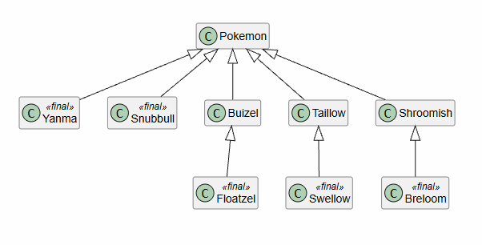

# Лабораторная работа №2: покемоны (ООП, Java)

Вариант: **753299**

Программа моделирует бой двух команд покемонов с помощью библиотеки `Pokemon.jar` (классы `Pokemon`, `Move`, `Battle`).
Классы покемонов и атак написаны своими руками на основе базовых классов библиотеки.

## Что реализовано

- 8 классов покемонов по цепочкам эволюции:
  Buizel → Floatzel, Taillow → Swellow, Shroomish → Breloom, а также Yanma и Snubbull
- 11 классов атак: 3 физические, 4 специальные, 4 статусные
- классы без наследников объявлены `final`
- в атаках переопределены методы `describe`, `applyOppEffects`, `applySelfEffects`, `checkAccuracy`
- классы разложены по пакетам `pokemons`, `moves.physical`, `moves.special`, `moves.status`

## Диаграмма классов



## Покемоны и их атаки

| Покемон | Родитель | Атаки |
|---|---|---|
| Buizel | Pokemon | Fake Out, Swagger |
| Floatzel | Buizel | Whirlpool, Rest (+ Fake Out и Swagger от Buizel) |
| Taillow | Pokemon | — |
| Swellow | Taillow | Fake Out, Swagger, Whirlpool |
| Shroomish | Pokemon | — |
| Breloom | Shroomish | Overheat, Rest, Twister |
| Yanma | Pokemon | Razor Leaf, Peck, Water Gun, Tail Whip |
| Snubbull | Pokemon | Overheat, Rest, Twister, Amnesia |

## Структура проекта

```
src/
├── Main.java
├── pokemons/
├── moves/physical/
├── moves/special/
└── moves/status/
lib/Pokemon.jar
```

## Как запустить

1. Открыть проект в IntelliJ IDEA.
2. Убедиться, что `lib/Pokemon.jar` подключён как библиотека (File → Project Structure → Modules → Dependencies).
3. Запустить класс `Main`.

## Результат работы

Вывод программы лежит в файле [output.txt](output.txt).
